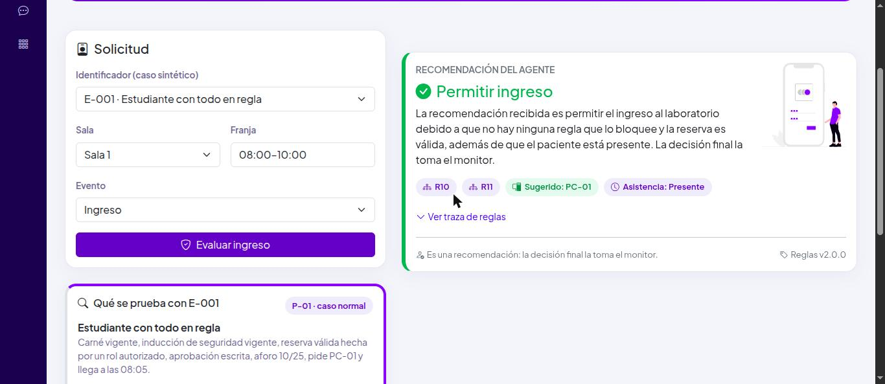
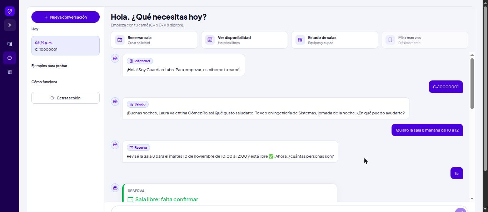
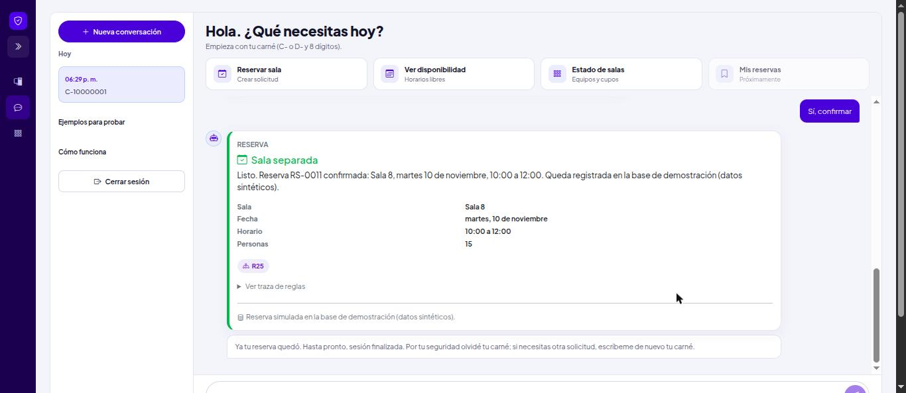
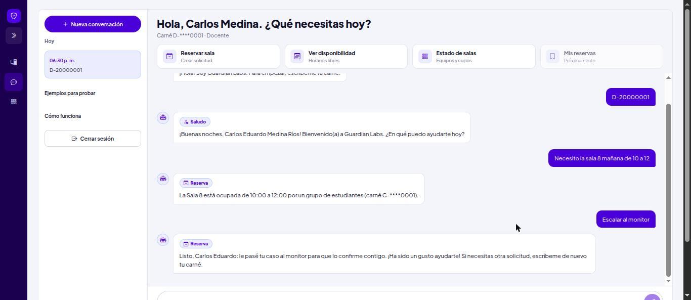
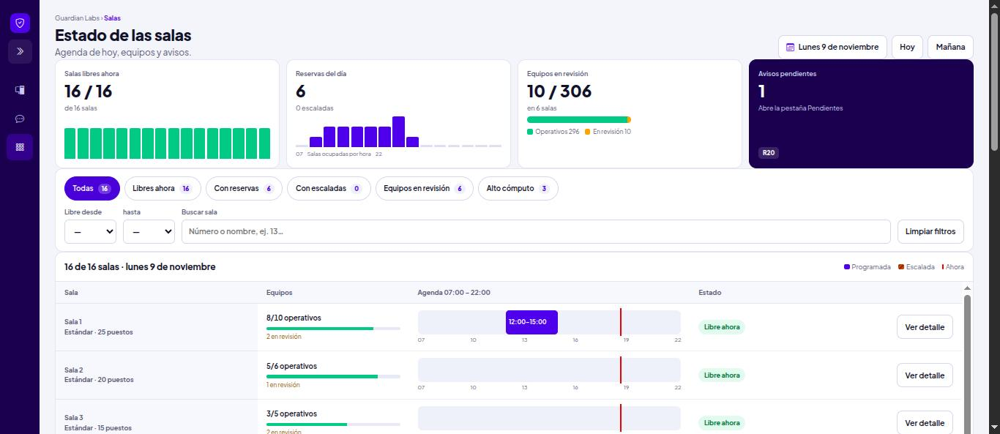
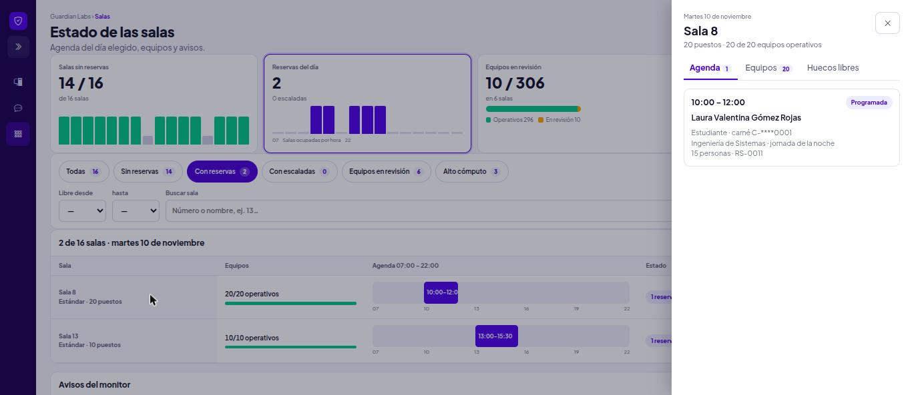
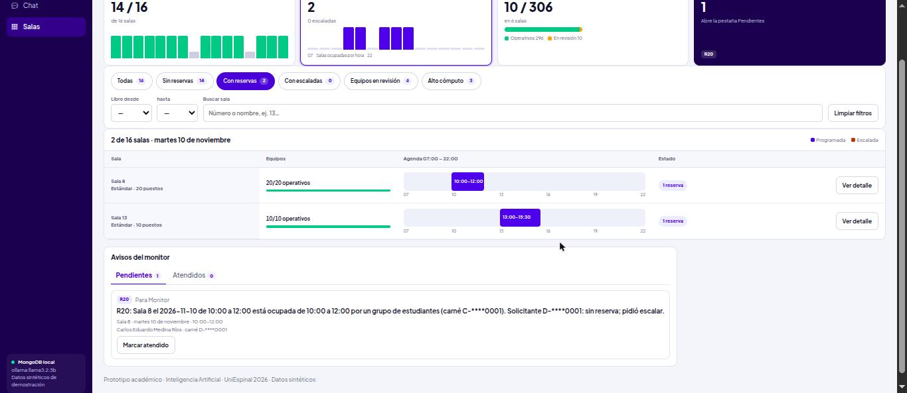

# Guardian Labs: agente lógico local para el ingreso y la reserva de salas de los laboratorios

Prototipo académico del curso **Inteligencia Artificial** (Ingeniería de Sistemas, UniEspinal, 2026B), Fase 2 del
*Taller-proyecto de agente lógico local*. El agente ayuda al **monitor** de los laboratorios de sistemas a decidir si
una persona puede ingresar, qué equipo usar y cómo registrar su asistencia. También atiende **reservas de salas por chat**
(identifica primero a la persona por su carné) y le muestra al monitor la agenda del día y los avisos que necesitan una persona.

**Autores:** Kevin Alexis Ayala Rodriguez y Esteban Páez Leonel.

> **Uso académico.** Todos los datos (personas, salas, equipos) son **sintéticos**. El agente entrega
> **recomendaciones**; la decisión final siempre es del monitor. No se debe usar con datos reales.

## Principio de diseño

| Componente | Archivo | Responsabilidad | No hace |
|---|---|---|---|
| Interfaz | `web/` | Recibe el caso, muestra decisión, explicación, reglas, versión y traza | Presentar la recomendación como decisión oficial |
| Canal HTTP | `agent/channels/http.ts` | Expone la API en `127.0.0.1` y valida la entrada | Aceptar entradas sin validar |
| Orquestador | `agent/orquestador.ts` | Filtra datos prohibidos, llama al modelo, **verifica** sus datos, llama al motor, registra | Dejar que el modelo decida |
| Modelo local (Ollama) | `agent/llm/` | Interpreta la intención, propone datos y redacta la explicación | Decidir, inventar reglas o datos |
| Herramienta lógica | `agent/tools/motor.ts` | Aplica R1–R13 por prioridad y especificidad, trata desconocidos y contradicciones | Delegar el resultado al texto del modelo |
| Base de conocimiento | `agent/rules/reglas.json`, `data/` | Reglas versionadas y hechos sintéticos | Mezclar datos reales |
| Registro y pruebas | `logs/`, `evals/` | Guarda entrada, versión, decisión y traza; pruebas automáticas | Guardar datos personales |

La misma entrada con la misma versión de reglas produce siempre la misma decisión: el motor es determinista y el
modelo solo redacta.

## Requisitos

| Herramienta | Versión probada | Nota |
|---|---|---|
| Node.js | 24.x | `.nvmrc` fija la versión (`nvm use`) |
| Ollama | 0.34.2 | <https://ollama.com/download> |
| Modelo | `llama3.2:3b` (~2 GB) | Ver la justificación en la guía de Ollama del informe |
| Navegador | Cualquiera reciente | Para la interfaz |

## Instalación

```sh
git clone <url-del-repositorio> agente-guardian-labs
cd agente-guardian-labs
nvm use                      # Node 24
npm install                  # dependencias del agente
npm --prefix web install     # dependencias de la interfaz
ollama pull llama3.2:3b      # modelo local
cp .env.example .env         # configuración (por defecto: Ollama)
```

Verificar Ollama: `ollama run llama3.2:3b "Hola"` debe responder en pocos segundos.

## Uso

```sh
npm run app
```

Arranca la API (`http://127.0.0.1:3000`) y la interfaz (`http://localhost:5173`) en una sola terminal.
`Ctrl+C` detiene ambas.

| Vista | Para qué |
|---|---|
| **Laboratorios** | Formulario de ingreso y casos de demostración (normal, desconocido, contradicción, combinado) con las reglas R1–R13 |
| **Chat** | Conversación con carné primero: saludo por nombre, reservas, disponibilidad, ocupación por fecha y avisos al monitor |
| **Salas** | Vista del monitor: 16 salas por fecha, indicadores, filtros, agenda 07:00–22:00, detalle de cada sala y avisos |

### Capturas

Tomadas el 9 de noviembre de 2026 con `npm run app`, MongoDB local y datos sintéticos.

**Laboratorios:** E-001 se permite por R10 y R11, con equipo sugerido y traza de reglas.



**Chat:** el agente pide el carné, saluda con nombre, programa y jornada, y revisa la sala antes de pedir más datos.



**Reserva confirmada:** RS-0011 queda en la base de demostración y el agente olvida el carné al terminar.



**Sala ocupada:** un docente pide la misma sala; el agente dice quién la tiene (carné enmascarado) y, si elige escalar, crea un aviso para el monitor.



**Salas del monitor:** indicadores, filtros y agenda del día.



**Detalle de una sala** y **avisos del monitor** (la barra lateral indica la base y el modelo en uso):





### Comandos

| Comando | Qué hace |
|---|---|
| `npm run app` | API + interfaz |
| `npm run serve` | Solo la API |
| `npm run dev -- E-006` | Evalúa un caso por consola |
| `npm run dev -- "Soy E-001, sala 1, ¿puede entrar?"` | Texto libre por consola |
| `npm run pruebas` | Motor, regresión, R12, privacidad, ayuda, intención, reservas, extractores, conversación, semilla y API del monitor |
| `npm run matriz` | Genera `docs/matriz-pruebas.md` (82 de 82 el 8-nov-2026) |
| `npm run seed` | Carga los datos sintéticos en la base del `.env` |
| `npm run prueba:mongo` | Comprueba reservas, conflictos, avisos y sesiones contra MongoDB |
| `npm run e2e` | Pruebas de punta a punta P-06 y P-07 con el modelo |
| `npm run typecheck` | Verificación de tipos (TypeScript estricto) |

## Inicio de sesión por rol

Desde el 14 de noviembre de 2026 la interfaz tiene **inicio de sesión** (`/ingresar`) con correo y contraseña para tres
roles. Las cuentas son sintéticas (dominio reservado `.test`) y están en [`docs/cuentas-de-prueba.md`](docs/cuentas-de-prueba.md).

| Rol | Qué puede hacer |
|---|---|
| Visitante (sin sesión) | Chat informativo: disponibilidad, ocupación, estado de las salas y ayuda. No reserva ni cancela. |
| Estudiante | Chat: reservas de grupo y cancelación de sus propias reservas. |
| Docente | Chat: reservas de clase (espacio académico) y cancelación de sus propias reservas. |
| Monitor | Vistas Laboratorios y Salas, avisos (marcar como atendidos) y detalle de reservas. En el chat solo consulta. |

- La identidad del chat sale del inicio de sesión: escribir un carné ya no identifica a nadie, y el carné de otra persona se rechaza.
- Contraseñas guardadas como hash `scrypt` con sal; token firmado con HMAC-SHA256 (8 horas), revocado al cerrar sesión.
- 5 contraseñas erradas seguidas bloquean el correo 5 minutos. El mismo mensaje para correo inexistente y clave errada.
- Carné vencido o con vigencia desconocida no inicia sesión (R16, R17 con aviso al monitor); el primer ingreso registra (R26).
- El navegador guarda la sesión en `localStorage` (`guardian.sesion`), cambia con la persona que entra y se borra al cerrar sesión o si el token vence.

## Reservas por chat

El chat también gestiona reservas de salas. Con la API, la identidad viene del inicio de sesión (sección anterior). Las pruebas de
flujo y la consola conservan el modo anterior, en que la conversación empieza por el **carné** (C- o D- y 8 dígitos):

1. con un carné vigente, el agente guarda la sesión (30 minutos) y saluda con nombre, programa y jornada;
2. la persona escribe la sala, la fecha y el horario en lenguaje natural («la sala 8 mañana de 10 a 12», «de 5:30 a 7:30»);
3. el agente revisa de una vez el horario (R15), si la sala está ocupada y el aforo, antes de pedir más datos;
4. pide las personas y, si es docente, los equipos, el alto cómputo y el espacio académico (entre sus propios espacios);
5. muestra la tarjeta de la reserva y pide confirmación; al terminar, olvida el carné.

Si la sala está ocupada ofrece «Ver otras salas» o «Escalar al monitor». Escalar crea un aviso para el monitor sin reserva.

Con esos datos, el **motor de reglas decide**; el modelo local solo conversa y redacta la respuesta. Si todas
las reglas se cumplen, la reserva se confirma y queda registrada en la base de demostración. Si una regla niega
la reserva, el chat lo explica y pide otro horario o sala; los conflictos se escalan a una persona.

| ID | Efecto | Descripción |
|---|---|---|
| R14 | `pedir_datos` | Falta un dato obligatorio de la solicitud de reserva: pedirlo, no concluir. |
| R15 | `negar` | Fecha u horario fuera de lo permitido (07:00–22:00, mínimo 30 minutos, hasta 30 días): negar y pedir otro horario. Sin tope de duración desde las reglas 2.1.0 (12-11-2026). |
| R16 | `negar` | Carné no vigente en carnetización: negar la reserva y remitir a carnetización. |
| R17 | `escalar_monitor` | Carné que no aparece en carnetización o con vigencia desconocida: no concluir y escalar al monitor. |
| R18 | `negar` | La sala pedida no alcanza para las personas o los equipos requeridos: negar esa sala y sugerir otras. |
| R19 | `escalar_monitor` | Los equipos operativos solo alcanzan si se cuentan equipos con estado desconocido o en conflicto: no concluir y escalar. |
| R20 | `escalar_monitor` | Un docente pide una sala ya separada por estudiantes en ese horario: informar quién la tiene, escalar al monitor para que acuerden y sugerir salas libres. |
| R21 | `escalar_monitor` | Un docente pide una sala ya separada por otro docente en ese horario: escalar al monitor, que lo remitirá a coordinación si hace falta, y sugerir salas libres. |
| R22 | `negar` | Un estudiante pide una sala ya separada en ese horario: negar esa sala y sugerir salas libres. |
| R23 | `negar` | Se necesita alto cómputo y la sala pedida no lo es: negar esa sala y sugerir salas de alto cómputo. |
| R24 | `negar` | Ninguna sala cumple las condiciones en ese horario: negar y pedir otro horario o menos personas. |
| R25 | `programar` | Ninguna regla bloquea: separar la sala en la base de demostración tras la confirmación. |
| R26 | `registrar_usuario` | Carné vigente en carnetización y aún no registrado: registrar al usuario sin pedir más datos personales. |
| R27 | `cancelar_reserva` | Cancelar una reserva desde el chat solo si está programada, aún no empieza y es del carné de la sesión (estudiante o docente titular); si no, negar sin revelar datos de la reserva. |

Las reservas son simuladas sobre datos sintéticos; el prototipo no reserva salas reales.

## Configuración (`.env`)

| Variable | Valor por defecto | Descripción |
|---|---|---|
| `PROVEEDOR` | `ollama` | `ollama` (local, el exigido por el taller) o `vercel` (solo comparación) |
| `MODELO_OLLAMA` | `llama3.2:3b` | Modelo local |
| `AI_GATEWAY_API_KEY` | vacío | Solo si `PROVEEDOR=vercel`. Nunca se sube al repositorio |
| `MODELO_VERCEL` | vacío | Modelo principal del Gateway (comparación) |
| `MODELOS_RESPALDO` | vacío | Modelos de respaldo del Gateway, separados por coma |
| `MODELO_TIEMPO_MS` | `120000` | Tiempo máximo de espera de una respuesta del modelo |
| `SESION_SECRETO` | aleatorio al arrancar | Firma de los tokens de sesión (32+ caracteres). Nunca se sube al repositorio |
| `PORT` | `3000` | Puerto de la API |

## Base de datos

Desde el 8 de noviembre de 2026 la base de demostración corre en **MongoDB local** (Community Server 8.0 con replica set
`rs0`). MongoDB Atlas sigue siendo una opción: solo cambia `MONGODB_URI` en `.env`. La cadena de conexión va únicamente
en `.env`, que no se sube al repositorio; nunca debe aparecer en el código, en la documentación ni en los commits.
La interfaz y `GET /salud` informan el tipo de base (`local`, `atlas`, `remota` o `memoria`), nunca la URI.

Cargar los datos sintéticos (16 salas, 306 equipos, 17 carnés, 7 usuarios y 3 reservas):

```sh
npm run seed
```

Restaurar la demostración desde cero:

```sh
npm run seed -- --reset --si
```

> **Advertencia:** `--reset` borra reservas, notificaciones, conversaciones, sesiones, bloqueos y contadores. Úsalo solo
> cuando quieras empezar de nuevo.

Para correr el prototipo sin base de datos, usa el repositorio en memoria:

```sh
REPOSITORIO=memoria npm run app
```

Para usar Atlas en lugar de la base local, sigue `docs/guia-mongodb.md`.

### MongoDB local con replica set `rs0`

Las reservas usan transacciones, que requieren un replica set. En Linux Mint 22 (base Ubuntu 24.04, *noble*):

1. Instala MongoDB Community Server siguiendo la guía oficial para Ubuntu 24.04 (*noble*).
2. Edita `/etc/mongod.conf` y añade el nombre del replica set:

   ```yaml
   replication:
     replSetName: rs0
   ```

3. Reinicia el servicio y inicia el replica set una sola vez:

   ```sh
   sudo systemctl restart mongod
   mongosh --eval "rs.initiate()"
   ```

4. En `.env` usa la URI local (ya está en `.env.example`, sin credenciales):

   ```sh
   MONGODB_URI=mongodb://127.0.0.1:27017/?replicaSet=rs0
   ```

Si activas autenticación en MongoDB, agrega el usuario a la URI en `.env` solamente; nunca en la documentación.

## Vista Salas del monitor

`/salas` muestra el estado de las 16 salas del día: indicadores con gráficas, filtros (el estado de la URL se puede
compartir), línea de tiempo 07:00–22:00, detalle de cada sala y avisos del monitor, que se pueden marcar como atendidos.
El calendario marca los días con reservas. Los datos son sintéticos; el carné aparece siempre enmascarado.
La barra lateral de navegación es la misma en Laboratorios, Chat y Salas. Diseño y decisiones: `docs/cambios-reservas.md`, sección 7.0.10.

## API

Todas las rutas escuchan solo en `127.0.0.1`. Las marcadas «monitor» exigen `Authorization: Bearer <token>` de una
sesión de monitor (401 sin sesión, 403 con otro rol).

| Método y ruta | Acceso | Cuerpo | Respuesta |
|---|---|---|---|
| `POST /login` | público | `{ correo, clave }` | `{ token, usuario }` (carné enmascarado) |
| `POST /logout` | con sesión | — | Revoca el token |
| `GET /yo` | con sesión | — | `{ correo, rol, exp }` |
| `GET /salud` | público | — | `{ ok, proveedor, repositorio, base }` (sin la URI) |
| `POST /mensaje` | público | `{ texto, sesion, laboratorio? }` | Respuesta del chat. Con token de estudiante o docente, la identidad es la del token; sin token, solo informa |
| `GET /disponibilidad` | público | consulta | Huecos libres por sala y fecha |
| `POST /evaluar` | monitor | `{ id_sintetico, laboratorio, franja, tipo_evento }` | `{ decision, explicacion }` |
| `GET /salas?fecha=` | monitor | — | 16 salas con equipos, equipos en revisión y reservas del día (carné enmascarado) |
| `GET /salas/laboratorios`, `GET /casos` | monitor | — | Vista Laboratorios |
| `GET /reservas`, `GET /reservas/dias?mes=`, `GET /reservas/:codigo` | monitor | — | Reservas, días con reservas y detalle de una reserva |
| `GET /notificaciones` | monitor | — | Avisos para el monitor |
| `PATCH /notificaciones/:id` | monitor | `{ estado: "atendida" }` | Marca un aviso como atendido |

Ejemplo:

```sh
TOKEN=$(curl -s -X POST localhost:3000/login -H "Content-Type: application/json" \
  -d '{"correo":"monitor.salas@uniespinal.test","clave":"Monitor2026!"}' | node -pe 'JSON.parse(require("fs").readFileSync(0)).token')
curl -s -X POST localhost:3000/evaluar -H "Content-Type: application/json" -H "Authorization: Bearer $TOKEN" \
  -d '{"id_sintetico":"E-002","laboratorio":"sala-1","franja":"08:00–10:00","tipo_evento":"ingreso"}'
```

```json
{
  "decision": {
    "decision": "negar",
    "reglas_aplicadas": ["R1"],
    "equipo_sugerido": null,
    "notificar": [],
    "estado_asistencia": "no_aplica",
    "hechos_desconocidos": [],
    "contradicciones": [],
    "version_reglas": "2.0.0",
    "traza": ["R1: Inducción de seguridad vencida: negar uso de equipos y remitir a inducción."]
  },
  "explicacion": "…redactada por el modelo local…"
}
```

Una entrada que no cumple el esquema devuelve `400` con el detalle de los campos.

## Flujo de una solicitud en texto libre

0. **Identidad:** sin carné en la sesión, el agente lo pide antes de atender; con un carné vigente saluda con una plantilla y recuerda la sesión 30 minutos.
1. **Datos prohibidos:** si el texto trae cédula, correo o teléfono, se rechaza sin llamar al modelo y sin guardar el texto.
2. **Guardia:** patrones de manipulación ("ignora las reglas", "tu prompt"…) se marcan sin consultar al modelo.
3. **Interpretación:** el modelo lee **todo** texto libre y devuelve JSON con la intención, qué se quiere reservar (`recurso`: sala u otra cosa) y los datos candidatos. Solo los botones de la interfaz se atienden sin modelo. «Quiero reservar un almuerzo» queda fuera de alcance.
4. **Verificación:** el orquestador contrasta los datos con el texto; lo que el modelo no pueda respaldar se descarta. Si falta el id o la sala, el agente pide aclaración.
5. **Decisión:** el motor aplica las reglas y devuelve un resultado estructurado con traza.
6. **Explicación:** el modelo redacta la explicación sin cambiar la decisión.
7. **Registro:** se guarda en `logs/evaluaciones.jsonl`.

## Reglas (versión 2.1.0: R1–R13 más R14–R26)

Las reglas R1–R13 se describen aquí; las reglas R14–R26 de las reservas por chat están en la sección
[Reservas por chat](#reservas-por-chat).

| ID | Prioridad | Condición | Efecto |
|---|---|---|---|
| R1 | 1 | Inducción de seguridad vencida | Negar uso de equipos |
| R13 | 2 (más específica) | Dato desconocido **y** fuentes en conflicto | Escalar sin concluir |
| R2 | 2 | Dato crítico desconocido | Escalar |
| R3 | 2 | Fuentes con estados incompatibles | Escalar y notificar a mantenimiento |
| R4 | 3 | Carné no vigente | Negar ingreso |
| R5 | 4 | Reserva creada por rol no autorizado | Escalar a coordinación |
| R6 | 4 | Aprobación verbal | Escalar a coordinación |
| R7 | 5 | Aforo completo | Negar ingreso nuevo |
| R8 | 6 | Necesidad de accesibilidad | Puesto accesible o escalar |
| R9 | 6 | Equipo no disponible | Excluirlo de las sugerencias |
| R10 | 7 | Nada bloquea y la reserva es válida | Recomendar ingreso |
| R11 | 8 | Llegada dentro de la tolerancia (15 min) | Presente; si no, tardía |
| R12 | 8 | Sin entrada al cierre de la franja | Sin registro (no ausente) |

La tolerancia de asistencia es un parámetro de `agent/rules/reglas.json` (`tolerancia_asistencia_min`).

## Contenidos de la guía (sección 5)

`npm run contenidos` genera `docs/contenidos/resultados.md` con los nueve contenidos de la Fase 2: qué
se usa en el agente (reglas, lógica de primer orden, representación del conocimiento e
incertidumbre) y qué se implementó solo como ejemplo con datos simulados, con su justificación
(probabilidad, modelo temporal, aprendizaje estadístico y refuerzo). Incluye el ejemplo en Python de
la sección 6 (`analisis/ejemplo_guia.py`). Con Ollama encendido, `npm run contenidos -- --llm`
agrega la comparación con el modelo local.

| Archivo | Contenido |
|---|---|
| `conocimiento/hechos.json` | Hechos con fuente, fecha y estado (generado) |
| `datos/observaciones.csv` | Observaciones de la entrevista al monitor (generado) |
| `datos/consultas_etiquetadas.csv` | 64 frases etiquetadas por intención (40 de ajuste y 24 de prueba) |
| `analisis/` | Un módulo por contenido y el generador |

## Pruebas

| Prueba | Caso | Resultado esperado |
|---|---|---|
| P-01 | E-001 | Permitir, sugerir equipo, presente |
| P-02 | E-002 | Negar por R1 |
| P-03 | E-003 / E-004 | Último cupo: permitir / aforo lleno: negar (R7) |
| P-04 | E-005 | Escalar por dato desconocido (R2) |
| P-05 | E-008 | Escalar por contradicción (R3), sugerir otro equipo, notificar a mantenimiento |
| P-06 | Texto | Fuera de alcance, sin decisión |
| P-07 | E-009 + texto adversarial | Escalar por R6, alerta a coordinación |
| P-08 | E-010 | Regresión: con tolerancia 10 min, solo la llegada a los 12 min cambia a tardía |
| P-09 | E-006 | Escalar por R13, sin sugerir PC-07 |
| P-10 | E-007 | Negar por R4 |
| P-11 | E-012 | Accesibilidad (R8): con puesto accesible libre sugiere PC-03; sin puestos accesibles libres, escala |

## Pruebas automáticas

`npm run matriz` genera `docs/matriz-pruebas.md`: el 8 de noviembre de 2026 pasaron **82 de 82** pruebas (16 de ingreso y
seguridad, 21 de reservas, 44 de conversación y 1 de identidad) con las reglas 2.0.0 y `ollama:llama3.2:3b`.

## Estructura

```
agente-guardian-labs/
├── agent/
│   ├── channels/             API Express (http.ts) y arranque (servir.ts)
│   ├── orquestador.ts        ciclo completo de una solicitud
│   ├── conversacion.ts       flujo de reserva por pasos y contexto
│   ├── sesion.ts             identidad, saludo por plantilla y cierre de sesión
│   ├── llm/                  proveedor, intérprete, guardia, redactor y respaldo
│   ├── tools/                esquemas, motor, reservas, extractores, privacidad y monitor
│   ├── store/                repositorio MongoDB (local o Atlas) y en memoria
│   ├── rules/reglas.json     base de reglas versionada (R1–R26)
│   └── instructions.md       reglas permanentes del agente
├── data/                     casos, equipos, salas, carnetización y programas sintéticos
├── evals/                    pruebas automáticas y matriz
├── docs/                     matriz, guías, bitácora de cambios y capturas del README
├── logs/                     registro local (no se sube al repositorio)
└── web/                      interfaz React + Bootstrap (Laboratorios, Chat y Salas)
```

## Solución de errores

| Síntoma | Causa probable | Solución |
|---|---|---|
| `fetch failed` / `ECONNREFUSED 11434` | Ollama no está corriendo | `ollama serve` o abrir la app de Ollama |
| `model "llama3.2:3b" not found` | Modelo sin descargar | `ollama pull llama3.2:3b` |
| La interfaz dice "API sin conexión" | La API no está corriendo | `npm run app` desde la **raíz** |
| `EADDRINUSE :3000` | Puerto ocupado | Cerrar el otro proceso o usar `PORT=3001` |
| Errores de sintaxis al iniciar | Node antiguo | `nvm use` (Node 24) |
| La explicación es imprecisa | Límite del modelo de 3B | La decisión no cambia; revisar la traza |

## Limitaciones conocidas

- Los ids, salas y equipos son sintéticos; los nombres reales de las salas dependen de la entrevista con el responsable.
- El modelo de 3B a veces redacta con imprecisiones; por eso la interfaz siempre muestra la traza.
- La guardia por patrones se puede evadir; es una primera capa, y el motor decide igual.
- El inicio de sesión es de prueba: contraseñas sintéticas documentadas, revocación de tokens en memoria (se pierde al reiniciar la API) y sin recuperación de contraseña. La API escucha solo en `127.0.0.1`.
- Por pedido del docente, el chat muestra nombre, programa y jornada de la persona identificada; todos son sintéticos y el carné se olvida al terminar la reserva.
- La interfaz todavía deja visible en la burbuja y en el historial un dato prohibido que escribe el usuario (el agente sí lo bloquea).
- La condición del taller pide MySQL local; el prototipo usa MongoDB local.

## Créditos y licencias de terceros

- Ilustraciones: [unDraw](https://undraw.co/license) (uso libre, sin atribución obligatoria).
- Íconos y favicon: [Bootstrap Icons](https://icons.getbootstrap.com/) (MIT).
- Dependencias: ver `package.json` y `web/package.json`.

## Nota de uso académico

Este código se entrega como evidencia del curso Inteligencia Artificial de UniEspinal. Puede revisarse y ejecutarse
con fines académicos. No está autorizado su uso con datos personales reales ni como sistema oficial de control de
acceso.
