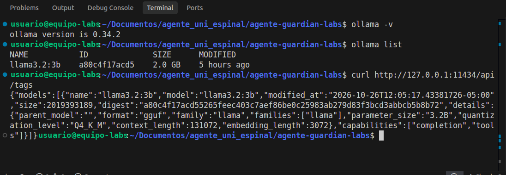
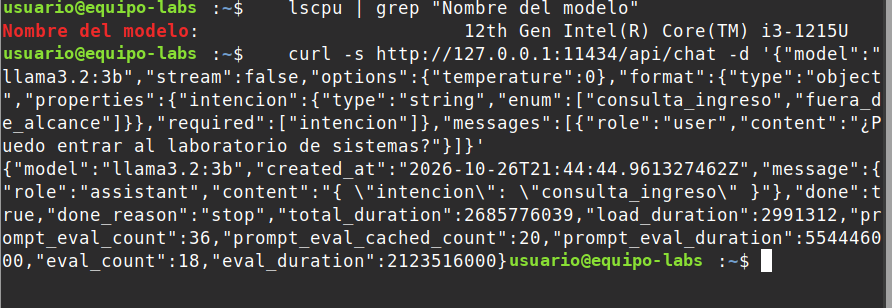
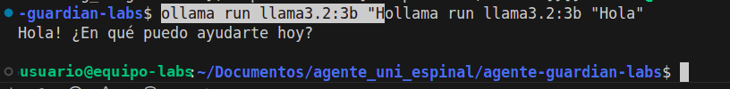

# Guía propia de instalación y configuración de Ollama

**Proyecto:** Guardian Labs, agente lógico local para el ingreso a los laboratorios de sistemas (UniEspinal).
**Autores:** Kevin Alexis Ayala Rodriguez y Esteban Páez Leonel.
**Fecha de la prueba:** 26 de octubre de 2026.

Esta guía describe cómo instalamos Ollama y el modelo en nuestro equipo y cómo lo verificamos, de forma que otro
equipo pueda repetir el procedimiento. No incluye números de serie ni datos de identificación del equipo; en las capturas, el usuario y el nombre del
equipo se reemplazaron por `usuario@equipo-labs`.

## 1. Equipo utilizado

| Elemento | Valor |
|---|---|
| Sistema operativo | Linux Mint 22.3 (kernel 6.8.0-147-generic) |
| Procesador | Intel Core i3-1215U (12.ª generación), 8 hilos |
| Memoria RAM | 11 GiB en total; cerca de 1,9 GiB disponibles con el editor, el navegador y la API abiertos |
| GPU | Intel UHD Graphics integrada (Alder Lake-UP3 GT1). No hay GPU dedicada, así que el modelo corre en CPU |
| Disco | SSD NVMe, 468 GB; 293 GB libres al momento de la prueba |
| Node.js | 24.22.1 |
| Ollama | 0.34.2 |
| Modelo | `llama3.2:3b` (3,2 B parámetros, cuantización Q4_K_M, 2,0 GB, contexto de 128K) |

## 2. Requisitos y fuente oficial

- Instalador y documentación oficiales: <https://ollama.com/download> y <https://docs.ollama.com/linux>.
- Unos 2,5 GB libres en disco para el modelo y Ollama.
- Conexión a internet solo para instalar y descargar el modelo; después el agente funciona sin conexión.

## 3. Instalación (Linux)

Comando oficial de instalación:

```sh
curl -fsSL https://ollama.com/install.sh | sh
```

El instalador registra Ollama como servicio del sistema. Para revisarlo:

```sh
systemctl status ollama      # debe decir "active (running)"
ollama -v                    # versión instalada
```

Descarga del modelo:

```sh
ollama pull llama3.2:3b
ollama list                  # debe aparecer llama3.2:3b, 2.0 GB
```

## 4. Verificación de la CLI y de la API local

**CLI.** `ollama -v` y `ollama list` confirman la versión y el modelo descargado.

**API local.** Ollama expone una API HTTP en `http://127.0.0.1:11434`. La ruta `/api/tags` lista los modelos
disponibles; la respuesta confirma el formato `gguf`, la familia `llama`, 3,2 B parámetros, cuantización `Q4_K_M` y
las capacidades `completion` y `tools`.

```sh
curl http://127.0.0.1:11434/api/tags
```



*Figura 1.* `ollama -v`, `ollama list` y la respuesta de `/api/tags`.

**Salida estructurada.** El agente le pide al modelo que responda con un esquema JSON (parámetro `format`). Prueba
manual:

```sh
curl -s http://127.0.0.1:11434/api/chat -d '{
  "model": "llama3.2:3b",
  "stream": false,
  "options": { "temperature": 0 },
  "format": {
    "type": "object",
    "properties": { "intencion": { "type": "string", "enum": ["consulta_ingreso", "fuera_de_alcance"] } },
    "required": ["intencion"]
  },
  "messages": [{ "role": "user", "content": "¿Puedo entrar al laboratorio de sistemas?" }]
}'
```

La respuesta trae `"content": "{ \"intencion\": \"consulta_ingreso\" }"`, es decir, JSON que el orquestador valida
con Zod antes de usarlo. En nuestra prueba la respuesta completa tardó 2,7 s (`total_duration`), con el modelo ya
cargado en memoria.



*Figura 2.* Respuesta de `/api/chat` con esquema JSON.

**Prueba interactiva:**

```sh
ollama run llama3.2:3b "Hola"
```



*Figura 3.* Respuesta del modelo en español. La primera respuesta tardó unos 5 segundos, mientras el modelo se carga
en memoria.

## 5. Selección y justificación del modelo

No escogimos el modelo por popularidad, sino por el trabajo que hace en el agente y por los límites del equipo. El
modelo **no decide**: solo clasifica la intención, propone datos (id, sala, evento) y redacta una explicación de 2
frases. La decisión la toma el motor de reglas.

| Criterio | `llama3.2:1b` | **`llama3.2:3b` (elegido)** | `llama3.1:8b` |
|---|---|---|---|
| Tamaño en disco | 1,3 GB | **2,0 GB** | 4,9 GB |
| Cabe en la RAM disponible (≈1,9 GiB libres + caché) | Sí | **Sí** | No, competiría con el sistema y causaría intercambio a disco |
| Español | Soportado oficialmente | **Soportado oficialmente** | Soportado |
| Capacidad `tools` y salida JSON | Sí | **Sí** | Sí |
| Calidad para clasificar y redactar | Menor | **Suficiente con ejemplos guía (few-shot)** | Mayor, pero no cabe |

Fuente de tamaños y contexto: biblioteca oficial de Ollama (llama3.2 y llama3.1). Meta declara el español entre los
idiomas con soporte oficial de Llama 3.2.

**Evidencia de que alcanza:** con ejemplos guía y una capa de filtrado previa, el clasificador de intención pasó 8 de
8 frases de prueba y las pruebas de punta a punta P-06 y P-07 pasaron completas. La redacción tuvo imprecisiones
(por ejemplo, invirtió el sentido de una aprobación verbal); eso no cambia la decisión, porque la decide el motor, y
por eso la interfaz siempre muestra la traza.

## 6. Integración con el proyecto

| Aspecto | Configuración |
|---|---|
| Archivo | `agent/llm/proveedor.ts` (única puerta al modelo) |
| Cliente | Librería oficial `ollama` para JavaScript, host `http://127.0.0.1:11434` |
| Temperatura | 0, para respuestas lo más estables posible |
| Salida estructurada | Parámetro `format` con el esquema JSON generado desde Zod |
| Variable | `PROVEEDOR=ollama`, `MODELO_OLLAMA=llama3.2:3b` en `.env` |
| Si Ollama falla | La decisión del motor se entrega igual; la explicación dice "Modelo no disponible; consulte la traza" |

## 7. Errores encontrados y soluciones

| Error | Causa | Solución |
|---|---|---|
| `fetch failed` / `ECONNREFUSED 127.0.0.1:11434` | El servicio no estaba corriendo | `systemctl start ollama` o `ollama serve` |
| `model "llama3.2:3b" not found` | Modelo sin descargar | `ollama pull llama3.2:3b` |
| Primera respuesta lenta | El modelo se carga en memoria | Es normal; las siguientes son más rápidas |
| Clasificación errada de frases fuera de alcance | Modelo pequeño sesgado hacia "consulta" | Ejemplos guía (few-shot) en el prompt |
| Frase de manipulación clasificada como fuera de alcance | Límite del modelo | Filtro determinista previo (`agent/llm/guardia.ts`) |
| Registro del servicio | Diagnóstico | `journalctl -e -u ollama` |

## 8. Referencias

Meta. (2024). *Llama 3.2 community license agreement*. https://www.llama.com/llama3_2/license/

Ollama. (2026). *Linux* [Documentación]. Recuperado el 26 de octubre de 2026 de https://docs.ollama.com/linux

Ollama. (2026). *llama3.2* [Biblioteca de modelos]. Recuperado el 26 de octubre de 2026 de https://ollama.com/library/llama3.2
